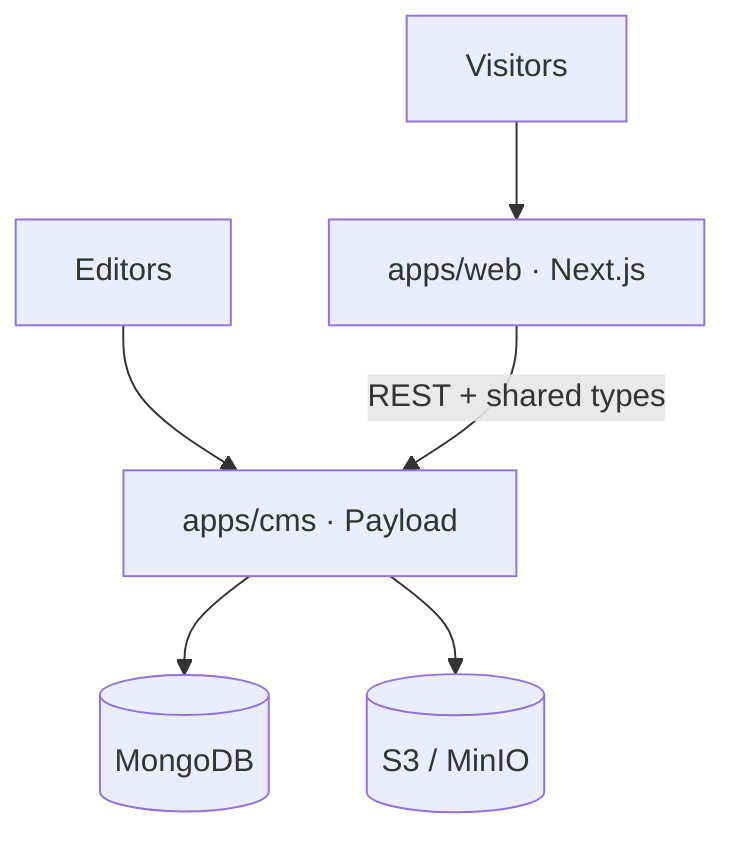

# AS Autosearch

Website for **AS Autosearch**, a car dealership / car-search business. Payload CMS 3 + Next.js 15 monorepo. Ukrainian is the default language and English is the second one.

## How to run the project

### Prerequisites

- Node.js 20+ (`.nvmrc`)
- pnpm 10 (pinned via `packageManager`; `corepack enable` picks the right version)
- MongoDB 7 — easiest via Docker:

  ```sh
  docker run -d --rm --name autosearch-mongo -p 27017:27017 mongo:7
  ```

### Setup

```sh
pnpm install

cp apps/cms/.env.example apps/cms/.env
cp apps/web/.env.local.example apps/web/.env.local
```

`apps/cms/.env` must contain `PAYLOAD_SECRET` and `DATABASE_URI`; the CMS refuses to start without them.

### Run

```sh
pnpm dev          # both apps
pnpm dev:web      # web only
pnpm dev:cms      # CMS only
```

| App | URL                         |
| --- | --------------------------- |
| Web | http://localhost:3000       |
| CMS | http://localhost:3001/admin |

On first visit the CMS admin asks you to create the first user.

### Other commands

| Command               | What it does                                |
| --------------------- | ------------------------------------------- |
| `pnpm build`          | Production build of all apps                |
| `pnpm generate:types` | Regenerate `apps/cms/src/payload-types.ts`  |
| `pnpm lint`           | ESLint in every package (`lint:fix` to fix) |
| `pnpm typecheck`      | TypeScript check in every package           |
| `pnpm format`         | Prettier check (`format:fix` to write)      |

## Project architecture

```
autosearch/
├─ apps/
│  ├─ cms/              @autosearch/cms — Payload CMS 3 on Next.js (:3001, /cms in prod)
│  └─ web/              @autosearch/web — public Next.js 15 site (:3000)
├─ packages/
│  ├─ config/           @autosearch/config — shared locales (ua default, en)
│  ├─ tsconfig/         @autosearch/tsconfig — shared TypeScript configs
│  └─ eslint-config/    @autosearch/eslint-config — shared ESLint flat config
├─ specs/               product and architecture spec
├─ .deploy/             compose / Traefik / seeds (planned)
├─ Dockerfile.cms       CMS image (planned)
├─ Dockerfile.web       web image (planned)
├─ turbo.json           Turborepo tasks
└─ pnpm-workspace.yaml  workspace: apps/*, packages/*
```



- **CMS** is the source of truth for content. Pages are built from blocks, and a `viewType` field picks how each page renders. Media is stored in S3/MinIO.
- **Web** reads content from the CMS REST API and imports the generated `payload-types` from `@autosearch/cms` as type-only imports. Styling is SCSS Modules with a single semantic token set and a light/dark theme switch.
- **Locales:** `ua` is the default and has no URL prefix; `en` lives under `/en/…`. Both are defined once in `@autosearch/config`.
- **Leads:** the booking form writes to Payload only, along the path form → `form-submissions` → `leads` inbox.
- **Tooling:** pnpm workspaces + Turborepo; ESLint and Prettier; no Tailwind.

The project is being built in milestones (`specs/08-bootstrap-roadmap.md`). Currently only the scaffold (Milestone 0) exists. Contributor conventions are in [`AGENTS.md`](./AGENTS.md), and the full spec is in [`specs/`](./specs/README.md).
