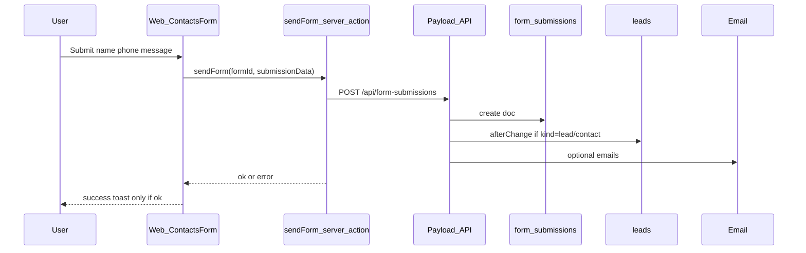

# 09 — Booking form & leads inbox

Spec for Autosearch’s booking / enquiry form. It mirrors what the AS Service site already does for the **primary inbox** (Payload), and deliberately **does not** call the secondary GoGym API.

Source behaviour reference: `booking-form-block` → `BookingForm` → `ContactsForm` → `sendForm` → `POST /api/form-submissions` → `form-submissions` + `contact-submissions` (+ optional email).

## Product intent

| | AS Service today | Autosearch |
| --- | --- | --- |
| User goal | “Book a service” / leave a callback request | Same pattern: request a call, test drive, trade-in, or general enquiry |
| Is it a calendar booking? | **No** — lead capture only | **No** — lead capture only (optional date field later, still not a workshop slot API) |
| Primary destination | Payload Admin inbox | Payload Admin inbox (`leads`) |
| Secondary destination | `api.beta.gogym.club/v1/landing/feedbacks` | **Drop** — do not ship |

Success UX (copy in CMS, both locales): thank the visitor; promise a human follow-up (e.g. “within an hour”).

## UI surface

Reuse the AS Service layout:

- CMS block: keep slug `booking-form-block` (or rename greenfield to `lead-form-block` — pick one and stick to it).
- Section: eyebrow + title / titleAccent + description + optional image + form card.
- Component: one shared form renderer (merge `ContactsForm` + `CMSForm`); Booking section is a thin wrapper.
- Also usable from Contacts page and from `CMSLink type='form'` (modal) with the same pipeline.

### Default fields (seed)

Same shape as AS Service booking form:

| Field name | Type | Required | Notes |
| --- | --- | --- | --- |
| `name` | text | yes | 3–50 chars validation on web |
| `phone` | phone-number | yes | digits; store as string |
| `message` | message | no | free text (car interest, question) |

Localized labels/placeholders/button/success via Form Builder (`ua` + `en`).

### Layout mapping

CMS block `layout` maps Form field **names** to slots (`nameField`, `phoneField`, `messageField`, optional `emailField`, `surnameField`, `termsField`) so one React form serves many Form docs.

### Autosearch extensions (same inbox)

Optional fields / hidden context — still one `sendForm` call:

| Extra | How |
| --- | --- |
| Lead type | Hidden field or Form `submissionKind` / block prop → `leads.type` (`callback` \| `test-drive` \| `trade-in` \| `finance` \| `general`) |
| Car of interest | Hidden `car` id when opened from `/cars/[slug]` |
| Preferred date | Optional date field (informational only) |
| Consent | Checkbox → stored on lead |
| UTM / page URL | Server action attaches from headers/referrer or client fields |

## Submit pipeline (primary inbox only)

### Rules

1. **Single write path:** `sendForm` → `${CMS_INTERNAL_URL|NEXT_PUBLIC_CMS_URL}/api/form-submissions`.
2. **No GoGym / external feedback API.** Do not port `submitLandingFeedback` or `gogymApiBase`.
3. **Fail closed on UX:** if Payload returns `!ok`, show error toast and **do not** show success / do not `reset()` (fix the AS Service bug).
4. Values normalized to strings before POST (`submissionData: [{ field, value }]`).
5. Unpopulated form relationship (`typeof form === 'string'`) → block renders `null`.
6. Public create on submissions stays open; add honeypot and/or rate limit before production.

## CMS side (what “primary inbox” means)

Mirror the existing form-builder hook behaviour, with a clearer Autosearch naming:

| Step | Collection / action | Notes |
| --- | --- | --- |
| 1 | `forms` | Definition: fields, labels, `submissionKind`, optional `emails[]` |
| 2 | `form-submissions` | Raw durable log of every submit (`form` + `submissionData`) |
| 3 | `leads` | Editor-facing inbox (replaces `contact-submissions`) when `submissionKind` is `lead` / `contact` |
| 4 | Email | If Form has `emails[]` and SMTP configured — same `{{field}}` substitution as today |

### `forms.submissionKind`

| Value | Effect |
| --- | --- |
| `none` | Only `form-submissions` (+ email if configured) |
| `lead` (preferred) / `contact` (alias for parity) | Also create `leads` row |
| `newsletter` | Optional newsletter collection (if kept) |

Seed a Form titled e.g. `AS Autosearch — Booking` with `submissionKind: 'lead'`, UA/EN labels, button “Записатись” / “Book” (or dealership-specific CTA).

### `leads` fields (inbox)

| Field | Source |
| --- | --- |
| `status` | `new` → `in-progress` → `won` / `lost` (Admin) |
| `type` | From form/block/hidden field |
| `name`, `phone`, `email`, `message` | Picked from `submissionData` by field name (same pickers as today’s hook) |
| `car`, `branch` | Optional relationships |
| `form`, `formSubmission` | Links back to Form Builder docs |
| `source` | Page URL |
| `utm` | Optional group |
| `consent` | Boolean |
| `readAt` / auto-mark-read | Keep AS Service Admin UX if useful |

Editors work primarily in **`leads`**, not raw `form-submissions` (raw remains for audit / email template debugging).

## Where it appears

| Page | Usage |
| --- | --- |
| Home | `#booking` section; nav/CTA anchors |
| Car detail | Same block; pass car id as hidden / `additionalField` |
| Contacts | Same form pipeline (contacts-form or shared lead-form) |
| Modal | `CMSLink type='form'` → FeedbackModal → same `sendForm` |
| Autosearch wizard | Final step calls same `sendForm` with wizard answers in `submissionData` or message |

## Seed & Admin checklist

1. Create Form (UA + EN) with name / phone / message; `submissionKind: 'lead'`.
2. Optionally configure Form `emails[]`.
3. Attach Form to `booking-form-block` on Home (and other pages); set `layout` field names.
4. Verify: submit in browser → `form-submissions` doc + `leads` doc with `status: new`.
5. Verify failure path: stop CMS → error toast, no success.
6. Confirm no outbound calls to gogym hosts in network logs.

## Keep / Adapt / Drop

| Piece | Verdict |
| --- | --- |
| `sendForm` → `/api/form-submissions` | **Keep** |
| `form-submissions` + afterChange emails | **Keep** |
| Editor inbox (`contact-submissions` → `leads`) | **Adapt** |
| `booking-form-block` UI | **Keep** (tokens + i18n) |
| Layout field-name mapping | **Keep** |
| Dual success toast / continue after Payload fail | **Fix** |
| `submitLandingFeedback` / GoGym | **Drop** |
| Real calendar / DMS booking API | **Out of scope** for v1 unless product adds it later |

## Acceptance criteria

- [ ] Visitor can submit name + phone (+ optional message) from Home booking section in `ua` and `en`.
- [ ] One Payload `form-submissions` document is created per successful submit.
- [ ] One `leads` document appears in Admin with `status: new` and parsed contact fields.
- [ ] Optional email fires when configured; otherwise inbox-only is enough.
- [ ] Payload errors surface as error toasts; success only on `ok`.
- [ ] No dependency on `GOGYM_*` env or `api.beta.gogym.club`.
- [ ] Car detail can attach car id to the same pipeline.
