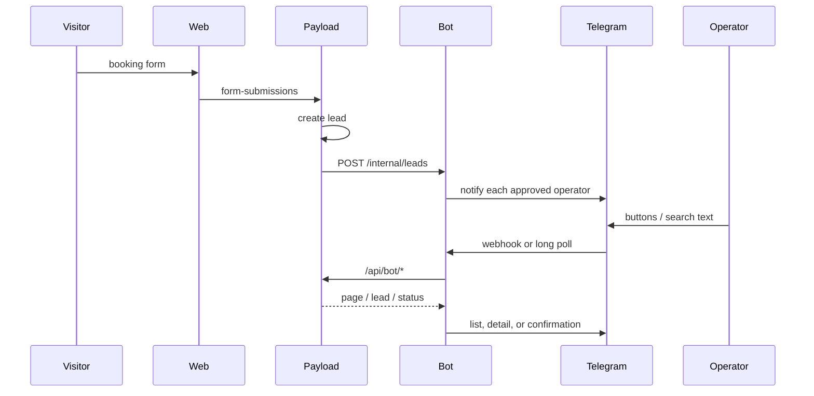

# 12 — Telegram bot (staff leads inbox)

Staff Telegram bot for **AS Autosearch** operators: request access in Payload Admin, then get notified about new leads and manage them with buttons. Ukrainian UI only. Not a customer-facing bot.

This document is the product + engineering contract. Implementation lives in `apps/bot` (`@autosearch/bot`) plus CMS collection/routes. Implementation order: [13-telegram-bot-roadmap.md](./13-telegram-bot-roadmap.md). When this file and [AGENTS.md](../AGENTS.md) disagree, this file wins — then update AGENTS.md.

## Product intent

| | Decision |
| --- | --- |
| Audience | Internal staff (managers / operators) |
| Language | Ukrainian only |
| Chat type | Private chats only (ignore groups / channels) |
| Primary job | Notify on new leads; list / search / filter / open / change status |
| Auth | Telegram user requests access → Payload Admin accepts / declines / blocks |
| Assignment | None in v1 — every **approved** operator gets every new-lead push |
| Source of truth | Payload `leads` + `bot-users` |

Success UX: an approved operator receives a detailed Telegram message when a visitor submits a booking form, and can handle the inbox without opening the CMS.

## Architecture

Third monorepo app alongside CMS and web:

| App | Package | Role |
| --- | --- | --- |
| `apps/cms` | `@autosearch/cms` | Source of truth; `bot-users`; internal bot API; fan-out on lead create |
| `apps/web` | `@autosearch/web` | Unchanged visitor surface |
| `apps/bot` | `@autosearch/bot` | grammY bot; Telegram webhook (prod) or long polling (dev); internal notify endpoints |

Stack for the bot:

| Area | Choice |
| --- | --- |
| Runtime | Node 20, TypeScript `5.7.3` |
| Framework | [grammY](https://grammy.dev) (HTTP server for webhook + health) |
| HTTP | Lightweight Node server (e.g. grammY webhook callback + tiny router). **No Next.js** |
| CMS access | HTTP to CMS internal bot routes with shared secret. Bot never imports Payload config |
| Session | In-memory per `chatId` (filters, page, awaiting-search flag). One replica. No Redis |
| UI | Reply keyboard (main menu) + inline keyboards (lists, filters, pagination, status) |

### Hard rule: do not use public `/api/leads` for bot reads

[`Leads`](../apps/cms/src/collections/Leads.ts) has an `afterRead` hook that, for authenticated Admin users, moves `status: new` → `in-progress` and sets `readAt`. Opening a lead from the bot must **not** trigger that path.

- Bot list/detail go through dedicated CMS routes under `/api/bot/…` that load docs with `overrideAccess` and **do not** change `status` or `readAt` on read.
- Status and `readAt` change only when the operator taps a status button (or when Admin edits the lead in Payload).

## Access (auth request → Admin)

### States (`bot-users.status`)

| Status | Bot behaviour |
| --- | --- |
| _(no row)_ | Show «Запросити доступ» |
| `pending` | «Запит на розгляді» — no lead features |
| `approved` | Full inbox features + new-lead notifications |
| `declined` | Message that access was declined; allow «Запросити доступ» again |
| `blocked` | Message that access is blocked; no re-request button |

### Flow

1. Operator opens the bot and sends `/start` (or any message while unauthorized).
2. Bot shows a reply keyboard with «Запросити доступ» (or a short explanation + that button).
3. On tap, bot `POST`s an access request to CMS with Telegram identity fields.
4. CMS upserts `bot-users` by `telegramId`:
   - new / `declined` → set `pending`, refresh profile fields, set `requestedAt`;
   - already `pending` → refresh profile, keep pending;
   - `approved` → no-op (bot already treats as authorized);
   - `blocked` → reject; bot tells the user they are blocked.
5. Payload Admin (group **«Телеграм»**) lists requests. An editor sets `status` to `approved`, `declined`, or `blocked`, optional `note`, and saves.
6. CMS `afterChange` on `bot-users` (when `status` changes) `POST`s `BOT_INTERNAL_URL/internal/auth` with the decision. Bot messages that Telegram user. Lead endpoints require the shared secret **and** an approved `telegramId`.

Create on `bot-users` is **not** public. Bot routes use `overrideAccess` after verifying `BOT_INTERNAL_SECRET`.

## Collection: `bot-users`

| Field | Type | Notes |
| --- | --- | --- |
| `telegramId` | text, required, unique | Telegram user id as string |
| `username` | text | Optional `@username` without `@` |
| `firstName` | text | From Telegram profile |
| `lastName` | text | Optional |
| `languageCode` | text | Stored for diagnostics; UI stays Ukrainian |
| `status` | select | `pending` \| `approved` \| `declined` \| `blocked` |
| `requestedAt` | date | Set / refreshed on access request |
| `decidedAt` | date | Set when Admin changes status away from `pending` |
| `note` | textarea | Admin-only comment |

Admin:

- Group: `{ en: 'Telegram', uk: 'Телеграм' }`
- `useAsTitle`: prefer `username` or `firstName` + `telegramId`
- Default columns: `status`, `username`, `firstName`, `telegramId`, `requestedAt`, `updatedAt`
- Access: read/create/update/delete require `req.user` (Admin only). Bot uses dedicated routes + `overrideAccess`.

## Lead features (approved operators)

Main menu (persistent reply keyboard), Ukrainian labels:

| Button | Action |
| --- | --- |
| «Заявки» | Paginated list (clears to default filters or keeps last session filters — prefer keep session until «Скинути») |
| «Пошук» | Prompt for free-text name / phone; next text message runs search |
| «Фільтри» | Inline filter panel |
| «Допомога» | Short how-to |

### New-lead notification

- Trigger: lead **create** only, after the existing fan-out in [`onFormSubmissionCreate`](../apps/cms/src/plugins/form-builder/hooks/onFormSubmissionCreate.ts) (or a `leads` `afterChange` create hook that runs once). Prefer a single place so form create and any future Admin-created leads stay consistent; if only form path creates leads in v1, hooking after `leads` create is enough.
- CMS `POST`s `BOT_INTERNAL_URL/internal/leads` with the lead payload (or id + fields) and `BOT_INTERNAL_SECRET`.
- Short timeout (e.g. 2–3s). Failures are logged; **form submission / lead create must still succeed** if the bot is down.
- If `BOT_INTERNAL_URL` is empty, CMS skips the call (local CMS without bot).
- Bot loads all `approved` operators (or receives ids from CMS — either is fine if documented) and sends one Telegram message each.
- Dedup by lead `id` so retries do not spam.
- Status updates do **not** fan out.

Message content (omit empty fields; Kyiv timezone for dates):

- Header: «Нова заявка»
- `type`, `status`
- `name`, `phone`, `email`
- `message`
- `request.*` (budget + currency, origin, carType, carBrand, otherCity, deliveryCity, priceRange, addons, expectedPrice)
- `source`, `utm.*`, `consent`
- `createdAt` (Europe/Kyiv)
- Inline button «Відкрити» → detail view for that lead

Keep under Telegram’s 4096-character limit; if needed, truncate `message` / `addons` with an ellipsis.

### Paginated list

- Page size: **5**
- Sort: `createdAt` descending
- Each row is an inline button: `Імʼя · телефон · статус` (truncate long names)
- Prev / next when more pages exist; show «Сторінка N з M»
- Opening a row shows the detail screen

### Search

- Free-text only after «Пошук»
- Name: case-insensitive substring on `name`
- Phone: strip non-digits on both sides; digits-only contains match
- Same pagination as list; empty result → «Нічого не знайдено» + back to menu actions

### Filters (combinable)

Inline buttons; session stores the active set:

| Filter | Values |
| --- | --- |
| Status | `new` / `in-progress` / `won` / `lost` (+ «будь-який») |
| Lead type | Same options as `leads.type` (+ «будь-який») |
| Origin (`request.origin`) | `usa` / `europe` / `korea` from `@autosearch/config` `carOrigins` (+ «будь-який») |
| Brand (`request.carBrand`) | Known `carBrands` values (+ «будь-який»). Custom free-text brands from the form still appear in search, not necessarily as filter chips |
| Date (`createdAt`) | Presets: сьогодні / 7 днів / 30 днів / увесь час |
| Reset | «Скинути» clears filters |

Custom date calendar is **out of scope** for v1.

### Detail + status change

- Render the same field set as the notification (omit empties).
- Four status buttons: «Нова» / «В роботі» / «Успішна» / «Відхилена» → `new` / `in-progress` / `won` / `lost`.
- Changing status calls CMS patch. Leaving `new` sets `readAt` if empty.
- Confirm with an updated detail message (or a short «Статус оновлено» + refreshed detail).
- Viewing detail alone must **not** change status/`readAt`.

### Callback data & session

Telegram `callback_data` max 64 bytes. Use short codes, e.g.:

| Code | Meaning |
| --- | --- |
| `l:<id>` | Open lead |
| `p:<n>` | Go to page n (current filter/search session) |
| `s:<status>:<id>` | Set status |
| `f:…` | Filter toggles (keep short; prefer session + tiny keys) |

Filter + page + awaiting-search state live in an in-memory `Map` keyed by `chatId`. One bot replica. Restart drops sessions; operator uses the main menu again. No Redis in v1.

## CMS internal API (`/api/bot/…`)

All routes require header auth with `BOT_INTERNAL_SECRET` (e.g. `Authorization: Bearer …` or `X-Bot-Secret`). Not intended for Traefik public exposure beyond the existing CMS `/cms` path — treat as internal; secret is mandatory.

Suggested surface (exact paths may vary; keep under `/api/bot/`):

| Method | Path | Purpose |
| --- | --- | --- |
| `POST` | `/api/bot/access-request` | Upsert `bot-users` pending request from Telegram identity |
| `GET` | `/api/bot/operators/:telegramId` | Auth status for that Telegram user |
| `GET` | `/api/bot/leads` | Paginated list + filters/search query params; requires approved `telegramId` |
| `GET` | `/api/bot/leads/:id` | Lead detail **without** Admin `afterRead` side effects |
| `PATCH` | `/api/bot/leads/:id/status` | Body `{ status }`; sets `readAt` when leaving `new` if empty |

List query params (illustrative): `telegramId`, `page`, `limit=5`, `q`, `status`, `type`, `origin`, `carBrand`, `datePreset`.

Implementation notes:

- Use Local API / `req.payload` with `overrideAccess: true` after secret check.
- Do not go through collection REST `find`/`findByID` in a way that runs the Admin mark-as-read hook for bot operators.
- Validate `status` against the existing select options.

## Bot HTTP surface

| Method | Path | Purpose |
| --- | --- | --- |
| `GET` | `/health` | Liveness |
| `POST` | `/telegram/webhook` | Telegram updates; verify `X-Telegram-Bot-Api-Secret-Token` === `TELEGRAM_WEBHOOK_SECRET` |
| `POST` | `/internal/leads` | CMS → bot new-lead notify (secret) |
| `POST` | `/internal/auth` | CMS → bot auth decision notify (secret) |

Internal routes are **not** published in Traefik labels. Only `/telegram` (webhook) is exposed publicly in prod; `/health` may stay internal-only or behind the same path prefix as needed for compose healthchecks (prefer container-local healthcheck to `http://127.0.0.1:3002/health`).

### Telegram mode

| Env | Behaviour |
| --- | --- |
| `TELEGRAM_MODE=webhook` + `TELEGRAM_WEBHOOK_URL` set | Prod: setWebhook on boot; receive updates at `/telegram/webhook` |
| `TELEGRAM_MODE=polling` or webhook URL unset | Dev/local: long polling; do not set webhook |

## UX copy (Ukrainian)

Copy lives in the bot app (e.g. `apps/bot/src/i18n/ua.ts`). No English UI in v1. Prefer short labels that fit Telegram buttons. Admin collection labels stay bilingual (`en` / `uk`) like the rest of Payload.

## Deploy & Docker

### Image

- Root `Dockerfile.bot`: same `turbo prune --scope=@autosearch/bot --docker` → install → `pnpm --filter @autosearch/bot build` (`tsc`) → runner `node dist/…` pattern as [Dockerfile.web](../Dockerfile.web) / [Dockerfile.cms](../Dockerfile.cms), without Next standalone.
- Port **3002**.

### Compose

**Prod** ([`.deploy/docker-compose.prod.yml`](../.deploy/docker-compose.prod.yml)):

- Service `bot` / container `autosearch-bot`, networks `edge` and `autosearch-network`.
- Traefik: `PathPrefix(\`/telegram\`)` on `WEB_DOMAIN`, priority **higher than web** (e.g. 50+), TLS, middlewares `autosearch-security` and `autosearch-rate-limit`.
- Env: token, webhook URL (`https://${WEB_DOMAIN}/telegram/webhook`), webhook secret, `BOT_INTERNAL_SECRET`, `CMS_INTERNAL_URL=http://cms:3001${CMS_BASE_PATH}`.
- CMS gains `BOT_INTERNAL_URL=http://bot:3002` and the same shared secret.

**Dev** ([`.deploy/docker-compose.dev.yml`](../.deploy/docker-compose.dev.yml)):

- Service with polling; no Traefik path required for Telegram.
- Optional host port for `/health` if useful.

### Env matrix

| Variable | Who | Notes |
| --- | --- | --- |
| `TELEGRAM_BOT_TOKEN` | bot | From @BotFather |
| `TELEGRAM_MODE` | bot | `webhook` \| `polling` |
| `TELEGRAM_WEBHOOK_URL` | bot | Public HTTPS webhook URL (prod) |
| `TELEGRAM_WEBHOOK_SECRET` | bot | Passed to Telegram as secret token |
| `BOT_INTERNAL_SECRET` | bot + cms | Shared CMS↔bot secret |
| `BOT_INTERNAL_URL` | cms | e.g. `http://bot:3002`; empty = skip notify |
| `CMS_INTERNAL_URL` | bot | e.g. `http://cms:3001` (dev) / `http://cms:3001/cms` (prod) |

Add runtime secrets to root `turbo.json` `globalPassThroughEnv`. Ship examples: `apps/bot/.env.example`, CMS/web deploy env files, `.deploy` env samples.

### Scripts & CI

- Root: `pnpm dev:bot`, `pnpm build:bot`.
- CI / deploy path filters: include `apps/bot/**`, `Dockerfile.bot`.
- Health: compose healthcheck on bot `/health`; CMS already has `/api/health`.

## Out of scope (v1)

- English (or any second) bot locale
- Customer conversations / public lead intake via Telegram
- Editing lead fields other than `status`
- Per-operator assignment or ownership
- Broadcasts on status change
- Custom date-range calendar
- Group / channel chats
- Multiple bot replicas / shared Redis session
- Inventory or non-lead CMS collections in the bot

## Acceptance criteria

- [ ] Spec and AGENTS.md describe three apps; `apps/bot` is Node/TS/grammY only.
- [ ] Unauthorized user can request access; Admin can approve / decline / block; user gets a Telegram message on decision.
- [ ] Approved user receives a detailed Ukrainian message on new lead create (form → leads), including available `request.*` fields.
- [ ] Approved user can paginate leads (5/page), search by name/phone, combine filters (status, type, origin, brand, date preset), open detail, change status.
- [ ] Opening detail via the bot does not auto-flip `new` → `in-progress`.
- [ ] Changing status from the bot updates Payload; leaving `new` sets `readAt` when empty.
- [ ] Prod bot serves Telegram via webhook under `/telegram`; CMS↔bot notify uses internal Docker URLs + shared secret; CMS works when bot URL is unset.
- [ ] Dev can run the bot with long polling.
- [ ] Form submission still succeeds if the bot is unreachable.
)
