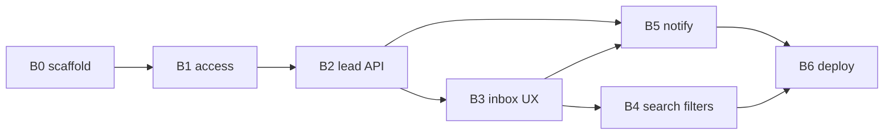

# 13 — Telegram bot roadmap

Ordered milestones to implement the staff Telegram bot. Product + engineering contract: [12-telegram-bot.md](./12-telegram-bot.md). This file is build order only (same split as [08-bootstrap-roadmap.md](./08-bootstrap-roadmap.md) vs domain specs).

Each milestone should leave touched packages green (`lint` + `typecheck`). Prefer finishing exits before starting the next milestone.



## Milestone B0 — Bot app scaffold

**Status:** done.

- [x] Create `apps/bot` (`@autosearch/bot`): Node 20, TypeScript `5.7.3`, [grammY](https://grammy.dev). No Next.js.
- [x] Package scripts: `dev` (tsx/watch), `build` (`tsc`), `start` (`node dist/…`), `lint`, `typecheck`.
- [x] Root scripts: `pnpm dev:bot`, `pnpm build:bot`; wire turbo filter.
- [x] `apps/bot/.env.example`: `TELEGRAM_BOT_TOKEN`, `TELEGRAM_MODE=polling`, optional webhook vars, `BOT_INTERNAL_SECRET`, `CMS_INTERNAL_URL`.
- [x] Add bot runtime secrets to root `turbo.json` `globalPassThroughEnv`.
- [x] HTTP server: `GET /health` (liveness). Long-polling mode when webhook URL unset / `TELEGRAM_MODE=polling`.
- [x] Private chats only stub (ignore groups). Ukrainian copy module stub (`apps/bot/src/i18n/ua.ts`).

**Exit:** `pnpm install` + `pnpm dev:bot` starts; `GET /health` ok without CMS; bot connects to Telegram via polling with a valid token (or fails clearly if token missing).

## Milestone B1 — Access (`bot-users`)

**Status:** done.

- [x] CMS collection `bot-users` per [12](./12-telegram-bot.md) § Collection; Admin group «Телеграм»; register in `payload.config.ts`; `pnpm generate:types`.
- [x] Access: Admin-only CRUD; create not public.
- [x] CMS routes (secret `BOT_INTERNAL_SECRET`):
  - `POST /api/bot/access-request` — upsert pending by `telegramId`
  - `GET /api/bot/operators/:telegramId` — status for that user
- [x] Bot: `/start` + unauthorized UX — «Запросити доступ», pending / declined / blocked messages; declined may re-request; blocked cannot.
- [x] Shared secret header check on CMS bot routes (`Authorization: Bearer` or `X-Bot-Secret`).

**Exit:** Telegram user requests access → Admin sees `pending` row → status reflected when bot re-checks operator endpoint. Manual Admin status change is enough for this milestone (decision push is B5).

## Milestone B2 — Lead bot API

**Status:** engineered in repo — smoke with approved `telegramId` + `BOT_INTERNAL_SECRET` (see curl examples below).

- [x] CMS routes (same secret + require approved `telegramId` where listed in [12](./12-telegram-bot.md)):
  - `GET /api/bot/leads` — paginated list (`limit=5`), sort `createdAt` desc; query params for `q`, filters
  - `GET /api/bot/leads/:id` — detail via Local API + `overrideAccess`
  - `PATCH /api/bot/leads/:id/status` — `{ status }`; set `readAt` when leaving `new` if empty
- [x] **Hard rule:** detail/list must **not** run Admin `afterRead` mark-as-read (`new` → `in-progress`). Do not use public `/api/leads` for the bot.
- [x] Validate status against existing select: `new` | `in-progress` | `won` | `lost`.

**Exit:** Smoke/curl: open detail leaves `status: new` unchanged; status patch updates Payload and sets `readAt` when leaving `new`.

```bash
SECRET=…   # BOT_INTERNAL_SECRET
TG=…       # approved telegramId
# list
curl -sS -H "Authorization: Bearer $SECRET" \
  "http://127.0.0.1:3001/api/bot/leads?telegramId=$TG&limit=5"
# detail (must keep status new)
curl -sS -H "Authorization: Bearer $SECRET" \
  "http://127.0.0.1:3001/api/bot/leads/<id>?telegramId=$TG"
# status
curl -sS -X PATCH -H "Authorization: Bearer $SECRET" -H 'content-type: application/json' \
  -d "{\"telegramId\":\"$TG\",\"status\":\"in-progress\"}" \
  "http://127.0.0.1:3001/api/bot/leads/<id>/status"
```

## Milestone B3 — Inbox UX

- Persistent reply keyboard for approved operators: «Заявки», «Пошук», «Фільтри», «Допомога» (search/filters can stub until B4).
- «Заявки»: inline list (5/page), row = name · phone · status; prev/next; page indicator.
- Detail screen: omit empty fields; under 4096 chars; four status buttons («Нова» / «В роботі» / «Успішна» / «Відхилена»).
- In-memory session per `chatId` (page; later filters). Short `callback_data` codes (`l:`, `p:`, `s:`).
- Gate all lead actions on approved operator status.

**Exit:** Approved operator can list → open → change status end-to-end against a seeded/local CMS.

## Milestone B4 — Search & filters

- «Пошук»: prompt for free-text; next message searches name (case-insensitive substring) or phone (digits-only contains).
- «Фільтри» inline panel — combinable: status, lead type, `request.origin` (`usa`/`europe`/`korea`), `request.carBrand` (known brands from `@autosearch/config`), date presets (сьогодні / 7 днів / 30 днів / увесь час); «Скинути».
- Session holds active filters + page; list API consumes them.

**Exit:** Combined filters + search drive the same paginated list; empty result shows Ukrainian empty state.

## Milestone B5 — Notifications

- On lead **create**, CMS `POST`s `BOT_INTERNAL_URL/internal/leads` with secret; short timeout (2–3s); log failures; **never** fail form/lead create if bot is down.
- Empty `BOT_INTERNAL_URL` → skip (CMS boots without bot).
- Bot `POST /internal/leads`: notify every `approved` operator; full field set per [12](./12-telegram-bot.md); «Відкрити» button; dedupe by lead id.
- On `bot-users` status change, CMS `POST`s `BOT_INTERNAL_URL/internal/auth`; bot messages that Telegram user.
- Status edits on leads do **not** fan out.

**Exit:** Booking form creates lead → approved users get Telegram message; Admin approve/decline/block notifies the requester; form still succeeds if bot is stopped.

## Milestone B6 — Deploy

- Root `Dockerfile.bot`: `turbo prune --scope=@autosearch/bot --docker` → install → `pnpm --filter @autosearch/bot build` → `node dist/…`; port 3002; healthcheck `/health`.
- `.deploy/docker-compose.dev.yml`: bot service, polling, env wiring.
- `.deploy/docker-compose.prod.yml`: bot service; Traefik `PathPrefix(/telegram)` priority above web; TLS + existing middlewares; `TELEGRAM_MODE=webhook`, `TELEGRAM_WEBHOOK_URL`, `TELEGRAM_WEBHOOK_SECRET`; CMS `BOT_INTERNAL_URL=http://bot:3002`.
- Env samples (cms/bot/deploy); CI + deploy path filters for `apps/bot/**` and `Dockerfile.bot`.
- Sync [AGENTS.md](../AGENTS.md) / [DEPLOYMENT.md](../DEPLOYMENT.md) / [.deploy/README.md](../.deploy/README.md) with bot ports and paths.

**Exit:** Prod webhook receives Telegram updates under `/telegram`; internal CMS↔bot calls stay on Docker network; local/dev still use polling.

## Explicit non-goals (v1)

Same as [12-telegram-bot.md](./12-telegram-bot.md) § Out of scope:

- English (or any second) bot locale
- Customer conversations / public lead intake via Telegram
- Editing lead fields other than `status`
- Per-operator assignment or ownership
- Broadcasts on status change
- Custom date-range calendar
- Group / channel chats
- Multiple bot replicas / shared Redis session
- Inventory or non-lead CMS collections in the bot
