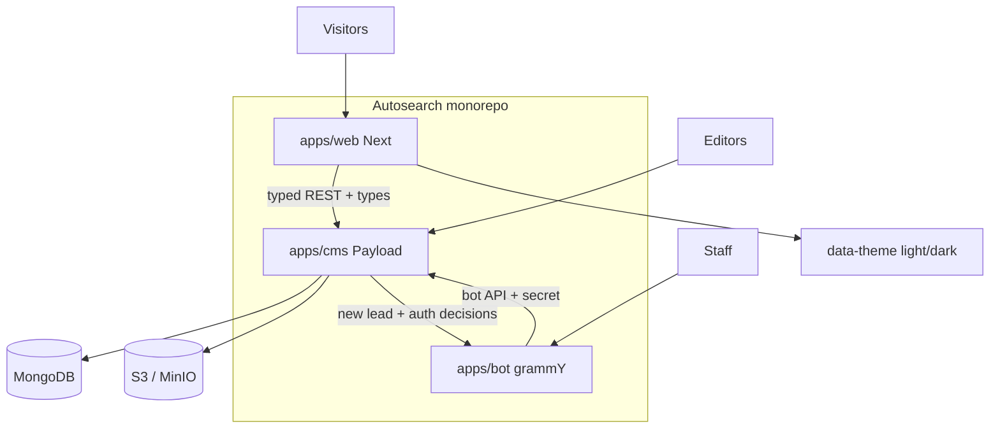

# AS Autosearch — starter spec

Reusable, code-derived blueprint for a new **AS Autosearch** car-dealership landing. Same architecture as the AS Service monorepo (`wayon/landing`), clean naming, **light/dark theme switch**, no GoGym/Wayon legacy surface.

**Inputs:** this repository’s code only (not Figma).  
**Output:** bootstrap a greenfield `@autosearch/*` monorepo from the docs below.

## One-page summary

| Dimension | Decision |
| --- | --- |
| Stack | Payload CMS 3 + Next.js 15 monorepo, MongoDB, S3/MinIO, next-intl, SCSS Modules |
| Apps | `apps/cms` (:3001, `/cms` in prod) + `apps/web` (:3000) + `apps/bot` (:3002, `/telegram` webhook in prod) |
| Locales | **Ukrainian (default)** + **English**. Codes `ua` / `en`; `ua` has no URL prefix, `en` is `/en/…` |
| Content | CMS blocks + `viewType` routing; almost no hardcoded copy; every UI string in both `translations/ua.json` and `translations/en.json` |
| Theme | Semantic tokens; `[data-theme=light\|dark]`; cookie + SiteSettings default; no legacy aliases |
| Domain | Import/search from USA·EU·KR; five services (inspection, turnkey, expert-for-a-day, diagnostics, travel); CMS price list; leads, blog; About/Contacts as Home sections (no `/about`/`/contacts` in v1; no inventory catalog, no search wizard) |
| Booking / leads | Same as AS Service **primary inbox**: Form Builder → `form-submissions` → Admin `leads` (+ optional email). Staff Telegram bot for lead notify + inbox. No GoGym. See [09-booking-and-leads.md](./09-booking-and-leads.md), [12-telegram-bot.md](./12-telegram-bot.md) |
| Naming | `@autosearch/*`, containers/buckets `autosearch-*` |
| Drop | Inventory / cars catalog, Autosearch search wizard, Explore, gamification blocks, subscriptions, gogym APIs, Tailwind prettier plugin, dual Wayon/`--as-*` palettes |

## Document index

| Doc | Contents |
| --- | --- |
| [01-architecture.md](./01-architecture.md) | Monorepo, versions, type sharing, target tree, Keep/Adapt/Drop |
| [02-cms-model.md](./02-cms-model.md) | Collections, globals, every block verdict, dealership collections |
| [03-frontend-patterns.md](./03-frontend-patterns.md) | Routing, RenderBlocks, i18n, SEO, forms, depth/caching |
| [04-design-tokens.md](./04-design-tokens.md) | Semantic tokens, light/dark values, WCAG, switch mechanism |
| [05-components.md](./05-components.md) | Primitives, sections, Header/Footer, design patterns |
| [06-infra-devex.md](./06-infra-devex.md) | Docker, compose, CI/CD, seeds, AGENTS.md outline |
| [07-domain-and-pages.md](./07-domain-and-pages.md) | Sitemap, page recipes, feature mapping, open questions |
| [08-bootstrap-roadmap.md](./08-bootstrap-roadmap.md) | Ordered milestones 0–7 |
| [09-booking-and-leads.md](./09-booking-and-leads.md) | Booking form + Payload leads inbox (parity with AS Service primary path) |
| [10-design-direction.md](./10-design-direction.md) | Design seed: palette, type, wireframes, principles, rejected defaults |
| [11-soft-launch-checklist.md](./11-soft-launch-checklist.md) | M7 soft-launch gates: engineering vs human/staging sign-off |
| [12-telegram-bot.md](./12-telegram-bot.md) | Staff Telegram bot: access requests, lead notify/list/search/status, webhook deploy |
| [13-telegram-bot-roadmap.md](./13-telegram-bot-roadmap.md) | Ordered milestones B0–B6 to implement the staff Telegram bot |

## Cross-cutting Keep / Adapt / Drop

### Keep

- pnpm + Turborepo app layout; Payload block recipe; typed SDK client; RenderBlocks + mappers; graceful-null CMS components; next-intl with Ukrainian default + English (`ua`/`en`, as-needed prefixes); SCSS Modules + breakpoint mixins; Docker turbo-prune + basePath assert; idempotent seeds; booking/lead form via form-submissions → Admin inbox (see [09](./09-booking-and-leads.md)); staff Telegram bot for leads (see [12](./12-telegram-bot.md)).

### Adapt

- Rename everything off `wayon-landing`; single semantic theme + toggle; merge form UIs; cache redirects; webhook revalidation; shared Button; slim block registry; env examples + validation.

### Drop

- Inventory (`cars` / `brands` catalogs, `/cars` routes); Autosearch search wizard; `@wayon-landing` / GoGym / Smarty branding and APIs; Explore system; subscriptions viewType; gamification blocks; dual token palettes and alias chains; default GTM id; unused Dockerfiles and dead components (`Banner`, unwired `SelectLanguage` until needed).

## How to use this spec

1. Resolve open questions in [07-domain-and-pages.md](./07-domain-and-pages.md) (§ Open questions).
2. Follow [08-bootstrap-roadmap.md](./08-bootstrap-roadmap.md) milestones in order.
3. When porting UI, prefer AS Service sections listed as **Keep** in [05-components.md](./05-components.md); restyle to semantic tokens from day one.
4. Treat [04-design-tokens.md](./04-design-tokens.md) “no aliases” as a hard rule in review.

## Source quirks called out (do not copy)

- CMS revalidation does not reach the web app.
- `force-dynamic` + `depth: 8` + global fetch tag `tag` is a blunt cache strategy.
- Contacts form can toast success after Payload failure and still calls gogym.
- Header “light” mode is hardcoded; dark Header CSS is dead.
- `AGENTS.md` font notes may lag `layout.tsx` (Toxigenesis + Gilroy are self-hosted).

---

*Generated as analysis deliverable for Autosearch greenfield. Living docs: update when product decisions land (dark palette sign-off). Locales are fixed: Ukrainian default + English. Inventory and search wizard are out of scope for v1.*
